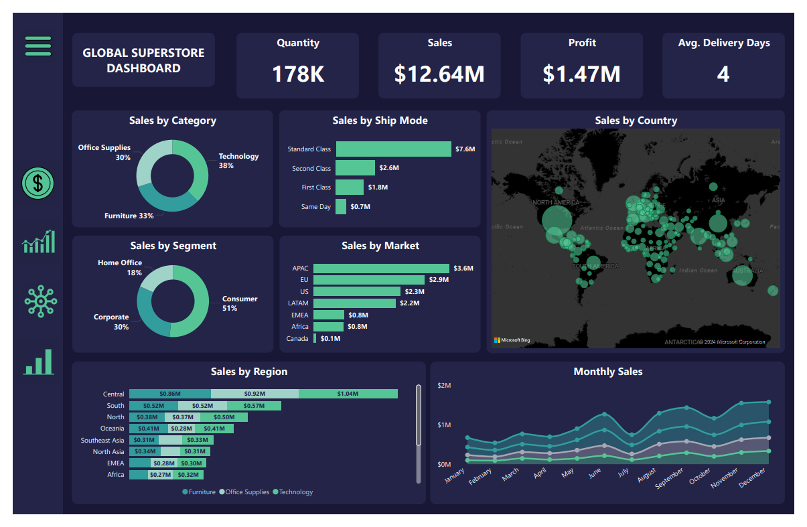
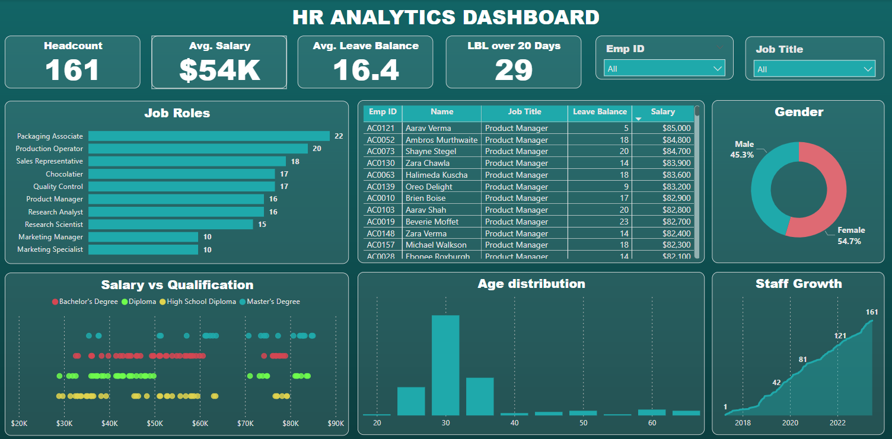
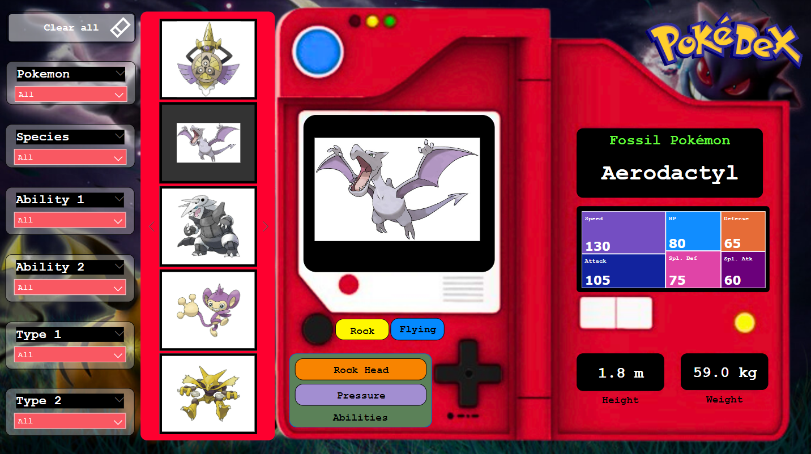

# Power BI Projects

Interactive Power BI reports and dashboards across sales, HR and a just-for-fun Pokédex. Each project folder has the `.pbix` file and a README with the full walkthrough.

## Projects

### [FurniturePro & Co. Retailers](Furniture%20Pro%20and%20Co.%20Retailers/)

A sales and customer case study for a furniture retailer: sales performance by region, segment and category, RFM customer segmentation, top salespeople, and What-If and Pareto analysis. Includes an insights PDF.

**Skills:** Power Query, DAX, What-If parameters, RFM analysis, Pareto analysis.

### [Global Superstore Sales](Global_Superstore_Sales/)

A sales dashboard for a global retail superstore, covering markets, regions, countries, categories, ship modes and time trends, with a bookmark-driven slicer panel and a custom theme.

**Skills:** data modelling, DAX, bookmarks, custom themes, dynamic filtering.

### [HR Analytics](HR-Analytics/)

An HR dashboard covering headcount and staff composition, salary by qualification, employee details and leave balance trends.

**Skills:** Power Query, HR metrics in DAX, visual customisation.

### [Pokédex](Pokedex/)

A Pokédex recreated in Power BI: Pokémon stats, types and abilities from a Kaggle dataset, with images pulled from an online Pokémon database.

**Skills:** web data sources, image URLs in visuals, custom report design.

## Open a project

Install [Power BI Desktop](https://powerbi.microsoft.com/desktop/) (Windows), download the `.pbix` file from the project folder and open it.
